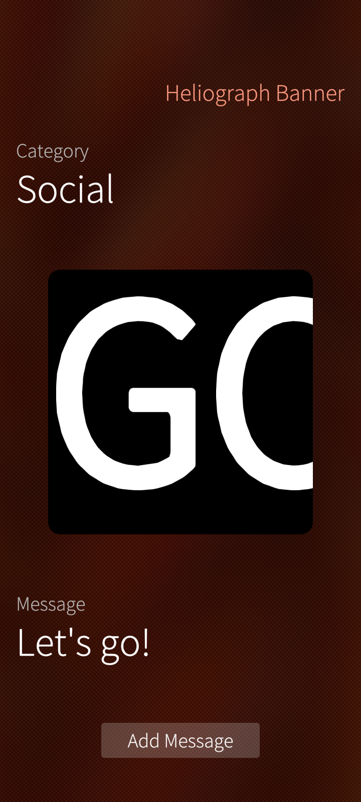

# asteroid-heliograph

A scrolling light message app for [AsteroidOS](http://asteroidos.org/)

Display scrolling text messages on your watch screen to communicate
across a room without sound. Choose from Emergency, Navigation, Social,
Fun, Emoji and Kaomoji categories. Drag horizontally while active to
adjust scroll speed. The screen auto-rotates to stay readable regardless
of wrist angle.

### Custom messages

Edit `/home/ceres/.local/share/asteroid-heliograph/custom.txt` to add
your own messages. Prefix with a category key to insert into an existing
category, or use `custom:` to create a personal category that appears
first in the list. The file ships with usage instructions as comments.
Changes take effect on next app launch.

https://github.com/user-attachments/assets/66c30bc3-fb30-4363-a997-241118051b46

### Screenshots


## SailfishOS

Reviewing the code? Start with [review-and-architecture-hints.md](review-and-architecture-hints.md).

The `sailfishos` branch is the SailfishOS version, built for Sailfish OS
5.1 on aarch64 and run on a Jolla C2. Since 1.3.0 the controls are
SailfishOS's own (see below).

- Pick a category and a message, tap the preview to show the banner full
  screen, tap again to close it. While it runs, drag along the banner to
  change the scroll speed (or, for emoji, the blink rate).
- Your own messages: **Add Message**, type, accept. The message goes into
  the Custom category, the first one, and is shown at once. In the Custom
  category, **Remove** deletes the shown message after the usual remorse
  countdown. Typed messages are kept by the app (dconf,
  `/apps/harbour-asteroid-heliograph/typed`).
- The app reads the accelerometer to keep the banner level, so it asks
  once for the Sensors permission when it is started from the app grid.
- The brightness is raised to maximum while a message is shown and set
  back when the app closes normally, as on the watch. If the app is
  killed, the brightness stays at maximum.
- Install: `devel-su pkcon install-local harbour-asteroid-heliograph-1.3.0-1.noarch.rpm`
- Build: `mb2 -t SailfishOS-5.1.0.11-aarch64 build` with the Sailfish
  Platform SDK.

The author tested the port on his C2 and had three things changed: the
full screen banner covers the whole screen at any tilt, the banner text
is bold, and the scroll speed goes up to 2000 px/s.

```
Disclosure: LLMGD-3 · origin O1 (LLM-ported; the author tested it on his Jolla C2 and had the banner area, font weight and speed limit changed; code not read; self-graded)
LLMGD: v0.2; assurance=A3; flags=U,T; origin={O0:.7,O1:.3}; origin_headline=O0; scope=port(code+assets+packaging+docs); graded-by=claude-opus-5-5; retrieval=author-side
```

The text input (1.1.0) was asked for on the forum and by the author.
Checked on a Jolla C2 with a test hook (`SFOS_SELFTEST_EDIT=1`) that
runs the same add and remove code as the buttons: umlauts and emoji
survive, a line break becomes a space, the Custom category appears and
goes again, and custom.txt is byte for byte as before afterwards. The
buttons, the text field and the keyboard have not been seen or used on
the phone yet.

```
Disclosure: LLMGD-2 · origin O1 (author-requested feature, default design by the LLM; file and list logic checked by a test hook on one Jolla C2; the UI not seen; self-graded)
LLMGD: v0.2; assurance=A2; flags=U,T; origin={O0:.8,O1:.2}; origin_headline=O0; scope=feature(code+docs); graded-by=claude-opus-5-5; retrieval=author-side
```

### Pure QML, one package for every phone (1.2.0)

App developer poetaster pointed out in the forum that these ports need
no compiled code. Since 1.2.0 Heliograph is QML only: the system's
`sailfish-qml` launcher runs it, and one `noarch` package serves aarch64,
32 bit ARM and x86, SailfishOS 3.4 to 5.1 (pkcon brings in the launcher,
libsailfishapp-launcher, if it is missing; the package is xz compressed
for rpm on 3.4). QML can read files but not write them, so typed
messages moved from custom.txt into dconf; that is the trade-off above,
chosen by the author. Messages typed with 1.1.0 are lines in custom.txt
and stay there: shown as before, removable only in the file.

Checked: installed and started on a Jolla C2 (5.1), the Jolla Tablet
(4.6) and a Jolla 1 (3.4); custom.txt is read on all three (the data
directory differs on 3.4, see above). Adding and removing typed
messages has not been tried on the phone yet.

```
Disclosure: LLMGD-2 · origin O1 (forum idea, the author's choice of the trade-off; LLM-implemented; start and file read checked by log on three devices; add/remove not tried; self-graded)
LLMGD: v0.2; assurance=A2; flags=U,T; origin={O0:.7,O1:.3}; origin_headline=O0; scope=packaging+code+docs; graded-by=claude-opus-5-5; retrieval=author-side
```

### Silica controls, live tile, smooth banner (1.3.0)

Forum user nthn pointed out that Silica is more than a transparent theme.
Up to 1.2.0 the app ran the watch interface inside a SailfishOS page, with
its own dark background over the ambience. 1.3.0 is a SailfishOS page:

- The ambience shows through. Category and message are pickers that open
  their list below them, the page scrolls so a long list fits.
- Add Message opens a dialog page; Remove uses the remorse countdown.
- The home screen tile is the banner, scaled down: black, the message
  scrolling through (or the emoji blinking) at the set speed.
- The six emoji of the Emoji category are Twemoji pictures in colour.
  SailfishOS ships the same artwork as a font, but Qt 5.6 draws that font
  only as outlines. Emoji in typed messages still come from the font.
- The banner moves on the render thread (an XAnimator); the timer that
  moved it before gave uneven steps that showed as stutter on the C2.
- custom.txt is gone: own messages are typed in the app. A custom.txt from
  an older version is no longer read.

 

Twemoji graphics (c) Twitter, Inc and other contributors, CC-BY 4.0
(`qml/images/twemoji/`).

Checked: the author used it on a Jolla C2 (5.1) and set the layout. Not
checked on the Jolla Tablet (4.6) or the Jolla 1 (3.4).

```
Disclosure: LLMGD-3 · origin O1 (prompted by a forum post; layout, live tile and emoji asked for by the author, set and used by him on a Jolla C2; LLM-implemented; self-graded)
LLMGD: v0.3; assurance=A3; flags=U,T; origin={O0:.5,O1:.5}; origin_headline=O1; scope=code+assets+packaging+docs; graded-by=claude-opus-5-5; retrieval=author-side
```
